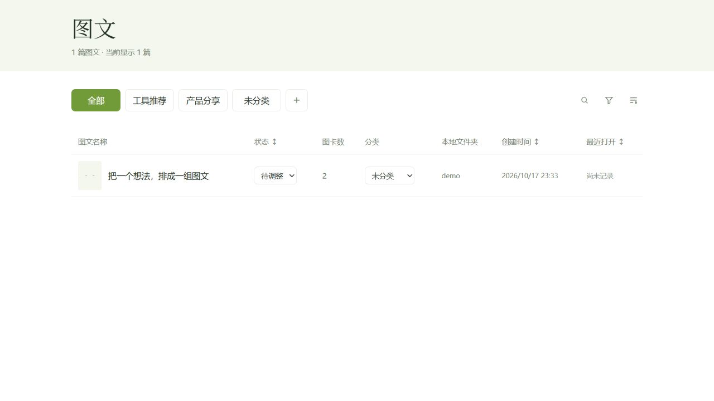
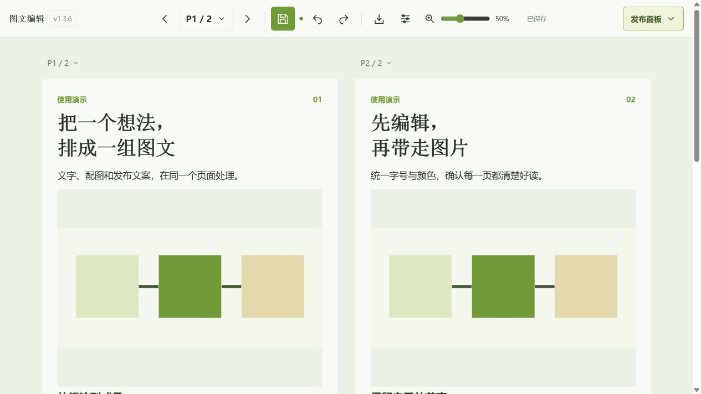
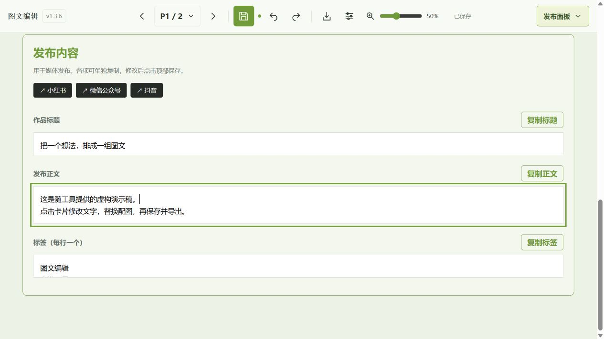

# 进化猫 · 创作工坊

在浏览器中编辑多页图文，统一排版、替换配图、导出 PNG，并准备发布标题、正文和标签。同一工作台也支持**视频发布准备**：预览视频与封面，编辑、保存和复制标题、正文、标签。图文和视频列表都支持隐藏、恢复和确认后永久删除。稿件与视频都保存在自己的电脑上。

**当前版本：1.15.1 · Windows 本地工具 · 不需要应用账号。**

> 当前是面向兼容 HTML 稿件的编辑工具，不是通用拖拽设计软件。首页可新建自由图卡，也可从仓库内的演示稿开始。PNG 导出仍有本机路径配置，首次安装请完成下方说明。

## 能做什么

- **管理多篇图文**：封面缩略图、图卡数量、分类、关键词搜索、日期筛选和排序。
- **自己管理进度**：待调整、已发布、已放弃，可手动切换并按状态排序。
- **直接修改卡片**：点击文字编辑；替换 PNG、JPEG 或 WebP 配图；支持撤销、重做与页面导航。每页页码旁可删除本页，至少保留一页；误删可撤销，修改后需保存。
- **统一排版**：调整整篇背景及标题、正文、注释的字体、字号和颜色；保留局部覆盖，缩放预览不改变导出尺寸。
- **保存与导出分开**：保存编辑稿，再按需导出当前页或全部页 PNG；删页保存会自动同步整套正式图片。默认卡片为 1080 × 1440。
- **准备发布材料**：分别编辑和复制标题、正文、标签，支持逐个复制标签；打开或复制文件夹路径；跳转六个平台入口。
- **视频发布准备**：左侧切到“视频”，打开内容后预览视频，编辑保存标题、正文、标签并逐段复制；后台链接只跳转，不上传平台。
- **多标签页工作**：不同篇独立保存；同篇发生版本冲突时提示处理，保留当前编辑。

发布入口只是跳转链接，工具不会代替你上传或发布。将状态改为“已发布”也不会执行平台操作。

## 界面预览

下面均为真实工具界面，使用仓库提供的虚构演示稿，不包含作者的实际图文或素材。

### 图文目录



### 卡片编辑与排版



### 发布文案



视频详情与图文共用发布内容区，材料区展示封面和视频。此处图文截图为早期界面参考，当前交互以版本说明为准。

## 安装和启动

### 1. 准备环境

当前以 **Windows** 为主要使用环境。安装 Git、Python 3.10 或更新版本、Node.js，以及 Microsoft Edge。Python 服务只用标准库，不需要 pip 安装依赖；PNG 导出另需 Node.js 的 Playwright。

```powershell
git clone https://github.com/wampeeHuang/evolution-cat-editor.git
cd evolution-cat-editor
```

### 2. 选择内容目录

编辑 `config.json`，将 `contentRoot` 改为你自己的**内容父目录的绝对路径**。路径使用正斜杠即可：

```json
{
  "contentRoot": "D:/my-articles",
  "port": 8797
}
```

首次体验时，可以把 `contentRoot` 指向克隆目录中的 `examples`，例如 `D:/apps/evolution-cat-editor/examples`。里面的 `demo` 是两页虚构图文，可用来练习编辑。建议先把 `demo` 复制到自己的内容目录，避免修改仓库示例。

服务只扫描内容父目录的直接子目录，每篇需要有包含 `document-state` 数据的 `index.html`，其 schema 为 `evolution-cat-photo-v2`。任意网页、Markdown 或图片文件夹不会自动变成图文稿。

视频板块是可选功能。给 `config.json` 再加一个 `videoRoot`，指向视频项目父目录（直接子目录按 `YYYYMMDD_标题/` 组织）即可：

```json
{
  "contentRoot": "D:/my-articles",
  "port": 8797,
  "videoRoot": "D:/my-videos"
}
```

不配置 `videoRoot` 时，视频板块会提示“尚未配置”，图文功能不受影响。想先试用，可把 `videoRoot` 指向仓库自带的 `examples/video-demo`（一条测试条画面 + 正弦波的虚构演示项目）。视频成片放在 `成片/`、`交付/`、`renders/` 或项目根目录，封面文件名以 `cover` 或 `封面` 开头/包含即可。

### 3. 启动编辑器

在仓库目录执行：

```powershell
python server.py
```

保持终端运行，在浏览器打开 **http://127.0.0.1:8797/**。停止时回到终端按 `Ctrl+C`。请先保存编辑，并等待导出任务完成。

当前前端服务地址及导出网络范围使用 8797，建议保留默认端口；只修改配置里的端口不能完成整套迁移。

### 4. 配置 PNG 导出

这一项仅在需要导出时配置。当前 `render.cjs` 仍保留开发机依赖路径，**其他电脑必须先调整**：

```powershell
npm install --no-save --package-lock=false playwright
```

打开 `render.cjs`，将开头的 Playwright 引入改为：

```javascript
const { chromium } = require('playwright');
```

再将 `chromium.launch` 中的 `executablePath` 改为本机 Edge 的实际路径。Windows 常见位置之一为：

```text
C:/Program Files (x86)/Microsoft/Edge/Application/msedge.exe
```

如果 Edge 位于其他位置，以本机为准。服务通过 `node` 命令执行渲染，因此 Node.js 必须在 PATH 中。安装好后重新启动服务，打开演示稿，先尝试导出当前页。

额外字体选择依赖可选的本地字体服务（8770），本仓库不包含该服务。没有它也可使用“沿用设计”和系统字体；请勿把依赖服务中的字体名称当成随仓库提供的字体文件。演示稿使用系统字体，不依赖额外字体服务。

## 一次完整使用流程

1. 在首页找到图文，选择分类与状态；需要时用搜索、日期筛选或列标题排序。
2. 点击标题进入编辑页，修改卡片文字、替换配图，打开排版设置统一字号和颜色。
3. 点击顶部**保存编辑稿**。保存会更新本篇 `index.html`，并同步生成或更新 `spec.json`；保存前的 HTML 副本保存在本篇 `_runtime/editor-recovery`。
4. 点击**导出 PNG**，选择当前页或全部页。队列会显示导出进度；若提示内容越界，先减少内容或调整字号再导出。
5. 进入**发布面板**，核对标题、正文与标签，分别复制，并打开导出的图片文件夹。
6. 自行前往平台上传和发布，再回到首页把状态改为“已发布”。
7. 发视频时点顶部“视频”，打开内容预览，编辑并保存标题、正文、标签，再到目标平台上传；发布状态在列表中手动修改。

正式发布图片区域读取本篇 `01_图卡/cards/card_*.png`；导出时将目标设为本篇 `01_图卡/cards`，即可在那里预览和打开。首次导出前该区域尚无正式图片。

## 内容如何保存

```text
自己的内容目录/              # config.json 的 contentRoot
└── 某篇图文/
    ├── index.html           # 权威编辑稿，包含 document-state
    ├── assets/products/     # 本篇配图
    ├── spec.json            # 保存时同步的数据
    ├── 01_图卡/cards/        # 建议的正式 PNG 输出位置
    └── _runtime/            # 本篇保存恢复副本
```

工具目录中的 `_runtime/catalog-metadata.json` 保存分类、状态、最近打开时间与回收站标记，属于需要备份的本地管理数据；`_runtime/jobs` 保存导出任务。它们不进入本工具 Git 仓库。移动或重命名篇目目录会改变篇目地址，请提前备份。

**视频与文案**：视频文件只读。标题、正文、标签以各项目原有发布文案文件为唯一来源，可在页面编辑保存；版本哈希阻止覆盖其他位置的新修改，保存前旧文本留在 `_runtime/video-copy-recovery`。其他文案段落保留。发布状态沿用项目根目录的 `.published` / `.parked` / `.abandoned`。

**公开仓库只提供工具、虚构演示稿和演示截图。** 内容目录与工具源码应分开放置；软件不会自动把本地稿件上传到 GitHub。如果你自行给内容目录建仓或手动上传文件，请自己核对公开范围。

## 常见问题

**首页没有图文？** 检查 `contentRoot` 的绝对路径、直接子目录层级和 `document-state` 格式。先用 `examples/demo` 验证入口。

**视频板块没有项目？** 检查 `config.json` 的 `videoRoot` 是否指向视频父目录、子目录名是否以 `YYYYMMDD_` 开头、里面是否有 `.mp4`/`.mov`/`.webm`；封面按 `cover*` 或 `*封面*` 命名，成片放在 `成片/`、`交付/`、`renders/` 或项目根目录。名含“测试/预览/preview/temp”的片段会被跳过。

**怎么新增一篇？** 首页点“新建自由图卡”，创建1080×1440的单张自由稿，支持文字选区格式、图片、拖动缩放旋转对齐与删除。保存后可从首页重开，PNG沿用原导出队列。自由稿保存在工具的 `_runtime/free-pages/`，是需要备份的持久用户数据，不得当缓存清理。现有照片卡片继续使用原编辑器，不自动转换。也可复制兼容稿件到内容父目录下；`examples/demo` 为虚构演示。自由图卡右侧“＋”可增页，最多50页，支持撤销；不支持任意HTML导入或在图卡内嵌入视频。

自由编辑器复用 `archlizheng/frontend-slides-editable` 的MIT运行时，许可与版本记录见 `web/runtime/upstream/`；界面使用Vivi令牌。字体二进制仅在本机 `_runtime/runtime-fonts/`，不随公开源码分发：`vivi/` 对应Vivi基础字体，`library/` 对应 `web/runtime/vivi/library/fonts.json` 中的已授权字体文件。迁移到新机器需同时备份/恢复此缓存或从原字体库补齐；缺失时浏览器回退系统字体，不能视为相同排版。

**保存提示冲突？** 另一个标签页或程序已经改动原稿。按提示下载当前编辑副本，再重新打开最新原稿，人工合并，避免直接覆盖。

**导出失败？** 先检查 Node.js、Playwright 引入路径和 Edge 路径；随后检查图片是否能加载、内容是否越界。导出只允许本地 8797 请求，外链图片应先保存成本篇本地配图。

**服务重启后任务没有继续？** 未完成导出会被标为失败，需要重新提交；已保存稿件不受影响。

**是否支持多人在线协作或自动发布？** 当前仅监听本机地址，没有应用账号、多人实时协作或自动发布功能。不要把它直接暴露到公网。

## 项目文件

`server.py` 提供本地服务，`web/` 为编辑界面（`web/video.*` 与 `web/video-detail.*` 是视频板块），`render.cjs` 负责 PNG 渲染。版本见 [VERSION](VERSION)，变更见 [CHANGELOG.md](CHANGELOG.md)。`verify.py` 是开发阶段的隔离验收脚本，依赖本地测试夹具，不是新安装后的通用自检命令。视频板块的演示项目在 `examples/video-demo`。

### 旧图文自由编辑试用

1.4.1先对灵感图库求反馈篇提供“创建自由编辑副本”：以已保存原稿在PNG同环境读取版式，生成独立的六页自由稿。原稿、原配图与原PNG不改写，副本沿用保存冲突检查与导出队列；顶部页码切页。标题、说明、页码、页脚与图片成为独立对象。该方式固定初始布局，改字变长后需手动调整位置，不保证像原模板一样自动挤排。当前入口仅此试用篇开放，不代表任意旧HTML都已兼容。自由稿支持右侧增页；删页与图卡内视频仍未开放。

### 删除与恢复

同一列表中，睁眼表示正常显示，点击后隐藏并沉底；闭眼表示已隐藏，点击恢复。隐藏只改变显示状态，保留本地文件。只有隐藏项显示永久删除按钮，点击后弹出一次确认，列明目录与文件范围；确认会删除整个作品目录。底部可按需勾选隐藏项集中清理。

### 自由图文整体排版与检查

顶部“统一排版”（T形SVG）提供整篇背景以及标题、正文、注释的字体、字号和自选颜色。工具尽量从已核验的原稿来源恢复类别，只有无法确定的对象需要确认，不要求逐个手动标注。整体操作可撤销，局部样式默认保留；恢复跟随会清除对应属性的局部覆盖。每页页码旁提供背景与添加文字/图片的SVG入口，添加目标就是该页；对象操作集成到对象自身，不再保留顶部对象设置面板。

排版检查等待字体排版完成，以1080×1440坐标检查文字越界、超固定文字框和与文字/图片的疑似重叠。页码菜单提示需检查页，问题可点击定位；重叠可确认保留，内容/布局变化后再次提醒。它不自动移动图片或缩字，检查标记不进入PNG。复杂透明图、旋转和有意叠放需人工判断，不能替代逐页看图。

统一排版采用紧凑表单，文字类别管理折叠在下方，排版检查紧随其后。恢复原设计指恢复本次打开时的排版，并保留此后独立修改的局部覆盖。

### 从原稿恢复文字类别

旧稿自由副本带有转换记录及source-index.html时，工具先校验快照SHA256，再按原字段、原页和对象编号匹配。能唯一对应的文字自动获得类别；歧义对象才留在未分类列表，悬停可看原因。此过程不改字、不移动图文、不按字号猜测。后续转换会保留来源字段、页和快照版本，改字后仍可追溯。

“文字类别与局部覆盖”内可撤销来源恢复，撤销后保存/刷新不会自动补回；需要时点击“从原稿恢复类别”主动重试。人工指定的类别始终保留。浏览器自动补标不会自动保存，需正常保存；工具端迁移会在_runtime/role-recovery下记录恢复点和外观不变证据。

### 删页后同步正式图片

删除图卡后点击保存，应用会自动整套渲染到01_图卡/cards，成功后把多余card_N.png移入作品_runtime/png-recovery/任务ID/，保留恢复副本。不点击保存仍可撤销。原照和其他素材不受影响。保存成功但同步失败时显示错误，可用整套导出重试；单页导出不清理其他页。
